# AWS IAM အသုံးပြုခွင့် စီမံခန့်ခွဲခြင်းနှင့် ဝင်ရောက်ခွင့် စမ်းသပ်မှု

AWS Identity and Access Management (IAM) တွင် user၊ group နှင့် policy များကို အသုံးပြုပြီး လုပ်ငန်းတာဝန်အလိုက် Amazon S3 နှင့် Amazon EC2 ဝင်ရောက်ခွင့်ကို ခွဲဝေစမ်းသပ်ထားသော lab portfolio ဖြစ်သည်။

[Burmese portfolio report PDF](AWS_IAM_Lab_Portfolio_Burmese.pdf) · [Google Docs တွင် import လုပ်နိုင်သော DOCX](AWS_IAM_Lab_Portfolio_Burmese.docx)

## Project ရည်ရွယ်ချက်

- IAM users နှင့် groups ၏ မူလအခြေအနေကို စစ်ဆေးခြင်း
- AWS managed policy နှင့် inline policy များ၏ ခွင့်ပြုချက်များကို ဖတ်ရှုခြင်း
- User သုံးဦးကို job function အလိုက် သက်ဆိုင်ရာ group ထဲသို့ ထည့်သွင်းခြင်း
- User တစ်ဦးချင်းစီအဖြစ် sign in ဝင်ပြီး ခွင့်ပြုထားသော access နှင့် ငြင်းပယ်ခံရသော access ကို အတည်ပြုခြင်း

## Lab environment နှင့် business scenario

Lab တွင် pre-created IAM users သုံးဦး၊ groups သုံးခု၊ Amazon S3 bucket နှင့် Amazon EC2 instance ကို အသုံးပြုခဲ့သည်။ EC2 instance ကို US East (N. Virginia) region တွင် စမ်းသပ်ခဲ့သည်။

| User | Group | သတ်မှတ်ထားသော access |
| --- | --- | --- |
| `user-1` | `S3-Support` | Amazon S3 read only |
| `user-2` | `EC2-Support` | Amazon EC2 read only |
| `user-3` | `EC2-Admin` | EC2 instance ကို view, start, stop |

`S3-Support` တွင် `AmazonS3ReadOnlyAccess`၊ `EC2-Support` တွင် `AmazonEC2ReadOnlyAccess` AWS managed policy များ ပါဝင်သည်။ `EC2-Admin` တွင် EC2 ကို describe, start, stop လုပ်ရန် `EC2-Admin-Policy` inline policy ပါဝင်သည်။ Screenshot များတွင် `RegionPinningPolicy` customer managed policy ကိုလည်း တွေ့ရသော်လည်း ၎င်း၏ rule များကို ဤ lab မှတ်တမ်းတွင် အသေးစိတ်မစစ်ဆေးခဲ့ပါ။

## ဆောင်ရွက်ခဲ့သည့်အဆင့်များ

1. IAM user နှင့် group စာရင်းများကို စစ်ဆေးခဲ့သည်။ စတင်ချိန်တွင် user များ၌ group membership မရှိသေးပါ။
2. Group များ၏ managed နှင့် inline policies ကို ဖတ်ရှုခဲ့သည်။
3. `user-1 → S3-Support`၊ `user-2 → EC2-Support`၊ `user-3 → EC2-Admin` အဖြစ် ထည့်သွင်းပြီး group သုံးခုစလုံးတွင် user count `1` ဖြစ်ကြောင်း စစ်ဆေးခဲ့သည်။
4. IAM user sign-in URL ကို အသုံးပြုပြီး private browser session တွင် user တစ်ဦးချင်းစီ၏ service access ကို စမ်းသပ်ခဲ့သည်။

## Access testing ရလဒ်

| User | အတည်ပြုနိုင်သော ရလဒ် | အထောက်အထား |
| --- | --- | --- |
| `user-1` | S3 bucket ကို ဖွင့်ကြည့်နိုင်သည်။ EC2 dashboard တွင် access denied ပြသည်။ | [S3 bucket](07_s3_bucket.png) · [EC2 denial](08_user1_ec2_denied.png) |
| `user-2` | Running EC2 instance ကို ကြည့်နိုင်သည်။ S3 bucket list ကို ကြည့်ခွင့်မရှိပါ။ | [EC2 instance](09_user2_ec2_view.png) · [S3 denial](10_user2_s3_denied.png) |
| `user-3` | EC2 stop request အောင်မြင်ပြီး instance state သည် `Stopping` ဖြစ်သွားသည်။ | [Stop result](11_user3_stop.png) |

`user-1` ဖွင့်ကြည့်ခဲ့သော S3 bucket တွင် object count `0` ဖြစ်သည်။ `user-2` ၏ EC2 stop denial နှင့် `user-3` ၏ start action တို့ကို screenshot ဖြင့် မမှတ်တမ်းတင်ထားသဖြင့် လက်တွေ့အတည်ပြုထားသော ရလဒ်ဟု မဖော်ပြထားပါ။

## Screenshot evidence

### IAM configuration

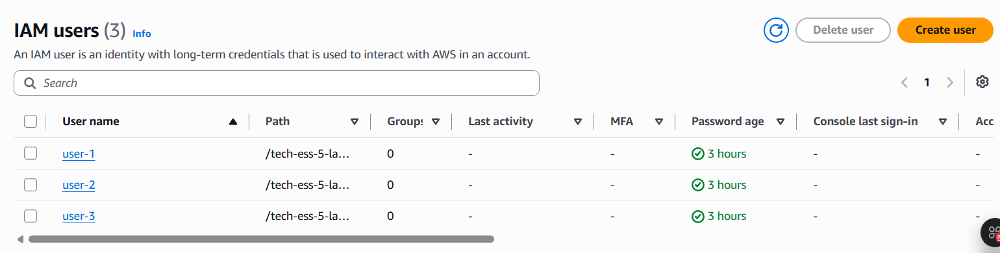

*ပုံ ၁ — စတင်ချိန်တွင် IAM user သုံးဦး၏ group count သည် 0 ဖြစ်နေသည်။*

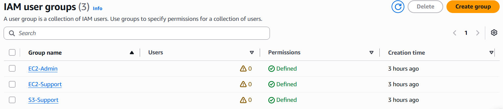

*ပုံ ၂ — EC2-Admin၊ EC2-Support နှင့် S3-Support group သုံးခုကို စစ်ဆေးထားသည်။*

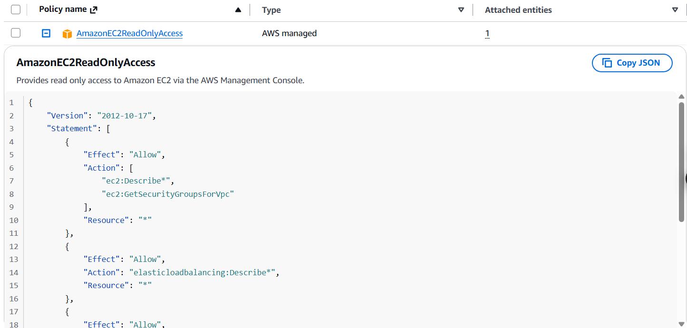

*ပုံ ၃ — EC2-Support ၏ `AmazonEC2ReadOnlyAccess` policy။*

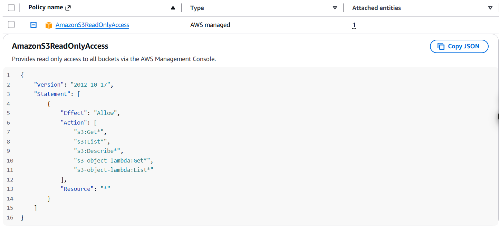

*ပုံ ၄ — S3-Support ၏ `AmazonS3ReadOnlyAccess` policy။*

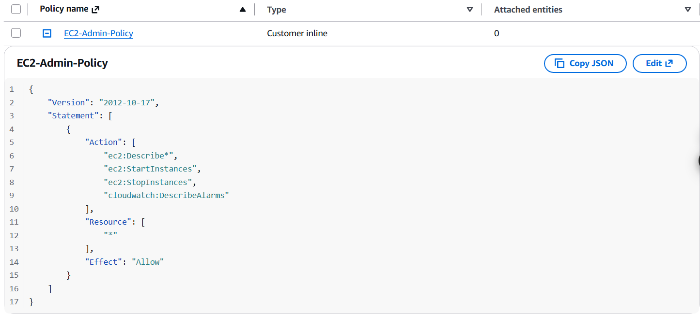

*ပုံ ၅ — EC2-Admin inline policy တွင် describe, start, stop action များ ပါဝင်သည်။*

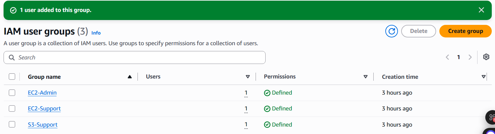

*ပုံ ၆ — Group သုံးခုစလုံးတွင် user တစ်ဦးစီ ရှိနေသည်။*

### Permission testing

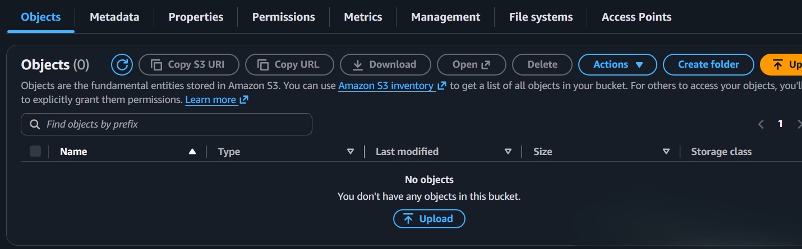

*ပုံ ၇ — `user-1` သည် S3 bucket ကို ဖွင့်ကြည့်နိုင်ပြီး object count 0 ဖြစ်သည်။*

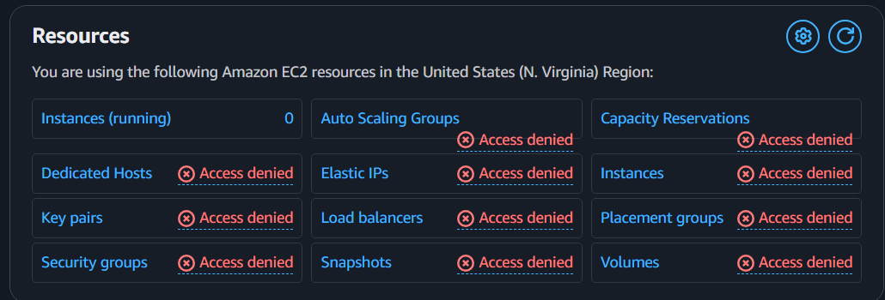

*ပုံ ၈ — `user-1` session ၏ EC2 dashboard တွင် access denial များ ပြထားသည်။*

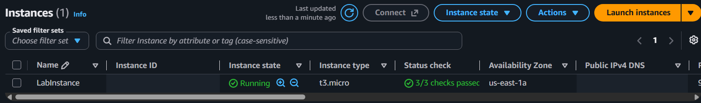

*ပုံ ၉ — `user-2` သည် Running EC2 instance ကို ကြည့်နိုင်သည်။*

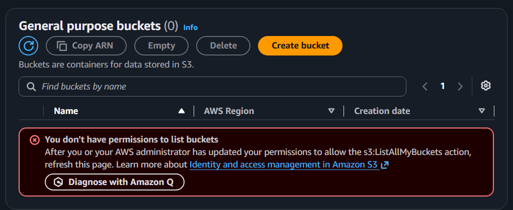

*ပုံ ၁၀ — `user-2` တွင် S3 bucket list ကြည့်ခွင့် မရှိပါ။*

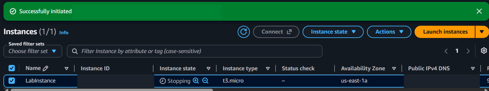

*ပုံ ၁၁ — `user-3` ၏ stop request အောင်မြင်ပြီး instance state သည် `Stopping` ဖြစ်သည်။*

## သင်ယူခဲ့သည့်အချက်များ

- Group အလိုက် permission ခွဲဝေခြင်းက တာဝန်တူ user များကို စနစ်တကျ စီမံနိုင်စေသည်။
- Policy ချိတ်ထားမှုကို စစ်ဆေးရုံဖြင့် မလုံလောက်သဖြင့် user အဖြစ် sign in ဝင်ပြီး ရလဒ်ကို လက်တွေ့စမ်းသပ်ရသည်။
- Access denied ရလဒ်သည် ခွင့်မပြုထားသော service access ကို ပိတ်ထားကြောင်း ပြနိုင်သည်။
- Policy က ခွင့်ပြုထားသော action နှင့် screenshot ဖြင့် အတည်ပြုထားသော action ကို ခွဲဖော်ပြရသည်။

## Source နှင့် privacy

ဤ portfolio သည် *AWS Cloud Technical Essentials: Introduction to AWS Identity and Access Management*, Version 1.0.1 lab guide ၏ scenario ကို အခြေခံထားသည်။ Lab guide စာသားအပြည့်ကို repo ထဲသို့ မကူးယူထားပါ။ Screenshot များကို ဖြတ်တောက်ဖျောက်ထားပြီး AWS account ID၊ ARN၊ public IP/DNS၊ request ID၊ IAM sign-in URL နှင့် credentials များကို repo တွင် မထည့်ထားပါ။

